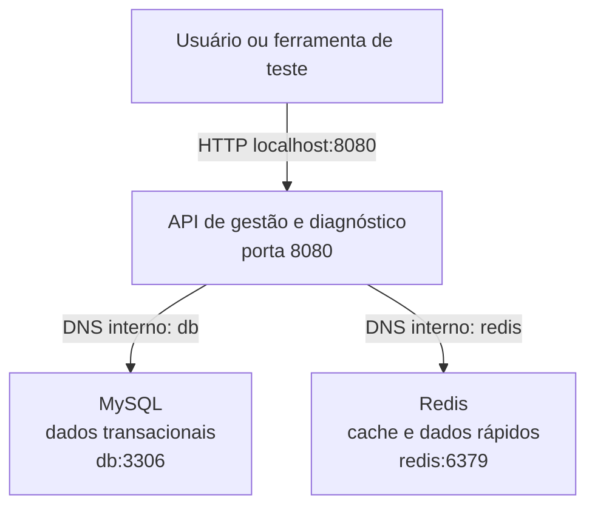

# MecaniQA


## Equipe: São Luiz

**Membros da Equipe:**
1. Bruno Moreira Lima
2. Claudio Pales Costa
3. Gabriel Honorato Santos Ferraz
4. Kéven Moraes Patrício
5. Tiago Ferraz de Novais

---

## Contexto do Projeto

A MecaniQA Tech é uma startup que fornece um sistema SaaS de gestão e diagnóstico automotivo para oficinas mecânicas. A aplicação principal, desenvolvida em Java, precisa lidar com dados transacionais das oficinas e utilizar serviços complementares para armazenamento e acesso rápido às informações.

No cenário descrito na documentação, a infraestrutura local apresenta instabilidade: a aplicação Java, o banco de dados e o cache competem pelos mesmos recursos. Este projeto representa a migração desse ambiente para uma base conteinerizada, isolada, reproduzível e preparada para diferentes formas de execução.

Para representar esse cenário, o projeto organiza três componentes:

- **API Java de gestão e diagnóstico automotivo:** representa o back-end do SaaS utilizado pelas oficinas.
- **MySQL:** representa o banco relacional responsável pelos dados transacionais da plataforma.
- **Redis:** representa o armazenamento de alta velocidade utilizado por dados temporários e cache.

A infraestrutura pode ser executada localmente com Docker Compose, representada de forma declarativa no Kubernetes e provisionada inicialmente com Terraform. O objetivo é demonstrar como os serviços são empacotados, conectados, persistidos e validados.

## Visão Geral da Arquitetura



A API, o MySQL e o Redis compartilham uma rede interna. Por isso, a API utiliza os nomes `db` e `redis` para localizar os serviços. Esses nomes são resolvidos pelo DNS interno do Docker Compose ou do Kubernetes; não é necessário informar o IP dos contêineres ou Pods.

### O que a API de validação representa

A aplicação em [src/main/java/com/mecaniqa/App.java](src/main/java/com/mecaniqa/App.java) representa o back-end Java do sistema da MecaniQA e usa o `HttpServer` nativo do Java para disponibilizar:

- `/`: confirma que a API está respondendo;
- `/health`: retorna o estado operacional da aplicação.

A aplicação é propositalmente simples e não depende de frameworks externos. Ela lê variáveis de ambiente para exibir a URL configurada do MySQL e o endereço do Redis. Nesta entrega, ela é um artefato de validação da infraestrutura: não realiza consultas reais ao MySQL nem operações reais no Redis. Em uma evolução do produto, esses serviços seriam utilizados pela API para registrar dados das oficinas, diagnósticos e demais informações transacionais.

## Principais Entregas

1. **Imagens Docker:** isolamento do back-end da MecaniQA, do banco de dados transacional e do serviço de cache em imagens independentes.
2. **Docker Compose:** execução local do ecossistema da plataforma, permitindo reproduzir o ambiente de uma oficina sem configurar cada serviço manualmente.
3. **Descoberta de serviços:** comunicação da API com o banco e o cache por `db` e `redis`, sem IPs fixos.
4. **Persistência:** volumes para preservar os registros transacionais do MySQL e os dados armazenados pelo Redis entre reinicializações.
5. **Kubernetes:** Deployments, Services e PersistentVolumeClaims para manter os componentes da plataforma disponíveis e organizados em um cluster.
6. **Terraform:** criação declarativa da rede, dos volumes e dos serviços de infraestrutura que sustentam a aplicação.
7. **Validação HTTP:** endpoint `/health` com resposta HTTP 200 e estado `UP`, simulando a verificação de disponibilidade necessária para o SaaS.

## Stack Tecnológica

- **Java 17+:** representação do back-end do SaaS de gestão e diagnóstico automotivo, baseada na biblioteca `HttpServer` do JDK.
- **Docker:** empacotamento e isolamento dos componentes.
- **Docker Compose:** orquestração local e configuração da rede entre serviços.
- **MySQL 8.0:** banco de dados relacional.
- **Redis Alpine:** serviço de cache.
- **Kubernetes:** execução declarativa, descoberta de serviços e persistência em cluster.
- **Terraform:** provisionamento declarativo da infraestrutura local usando o provider Docker.

## Estrutura do Repositório

```text
.
├── src/main/java/com/mecaniqa/
│   └── App.java                  # API Java de teste
├── build/
│   ├── classes compiladas        # Artefatos gerados pela compilação
│   └── app.jar                   # JAR usado pelo Docker
├── docker/
│   ├── mysql/Dockerfile          # Imagem customizada do MySQL
│   └── redis/
│       ├── Dockerfile            # Imagem customizada do Redis
│       └── redis.conf            # Configuração do Redis
├── k8s/
│   ├── api.yaml                  # Deployment e Service da API
│   ├── mysql.yaml                # MySQL, Service e persistência
│   └── redis.yaml                # Redis, Service e persistência
├── terraform/
│   └── main.tf                   # Provisionamento local com Terraform
├── docs/oat1/                    # Documentação e guias de referência
├── Dockerfile                    # Imagem da API Java
├── docker-compose.yml            # Orquestração local
└── README.md                     # Guia do projeto
```

## Como Executar pela Primeira Vez

O fluxo recomendado para iniciantes é utilizar Docker Compose. Ele inicia a API, o MySQL e o Redis com um único comando.

### 1. Pré-requisitos

Instale e deixe em execução:

- Docker Desktop com o Docker Compose;
- Java 17 ou superior, caso deseje compilar a API localmente;
- Terraform, caso deseje executar o provisionamento por código;
- `kubectl`, caso deseje utilizar Kubernetes;
- K9s, caso deseje monitorar o cluster em uma interface de terminal.

Para confirmar as ferramentas no PowerShell:

```powershell
docker --version
docker compose version
java -version
javac -version
terraform version
kubectl version --client
```

Docker, Terraform e `kubectl` são opcionais para testes que não utilizem suas respectivas camadas. Java é necessário para recompilar a aplicação; o JAR já existente em `build/app.jar` é utilizado pela imagem Docker.

### 2. Compilar a aplicação Java

Execute na raiz do repositório:

```powershell
javac -d build src/main/java/com/mecaniqa/App.java
jar cfe build/app.jar com.mecaniqa.App -C build .
```

O primeiro comando gera as classes compiladas. O segundo empacota essas classes no arquivo `build/app.jar`, que é copiado pelo [Dockerfile](Dockerfile) para dentro da imagem.

### 3. Conferir o Compose antes de iniciar

```powershell
docker compose config
```

Esse comando interpreta o `docker-compose.yml` e mostra a configuração final. Se houver erro de sintaxe, variável inválida ou estrutura incorreta, o problema deve ser corrigido antes da inicialização.

### 4. Iniciar os serviços

```powershell
docker compose up --build
```

O parâmetro `--build` força a reconstrução das imagens locais. Na primeira execução, o Docker também poderá baixar as imagens base e isso pode levar alguns minutos.

A API estará disponível em:

- `http://localhost:8080/`
- `http://localhost:8080/health`

Para executar em segundo plano:

```powershell
docker compose up --build -d
```

### 5. Parar os serviços

Para parar os contêineres sem apagar os volumes:

```powershell
docker compose down
```

Para parar os contêineres e remover os volumes, apagando os dados persistidos:

```powershell
docker compose down -v
```

## Como Validar a Execução

### Verificar os contêineres

```powershell
docker compose ps
docker ps
```

O resultado esperado é encontrar os serviços `mecaniqa-api`, `mecaniqa-db` e `mecaniqa-redis` em execução.

### Testar a API no PowerShell

O parâmetro `-UseBasicParsing` evita o prompt de segurança do Windows PowerShell:

```powershell
$resposta = Invoke-WebRequest -Uri http://localhost:8080/health -UseBasicParsing
Write-Host "StatusCode : $($resposta.StatusCode)"
$resposta.Content
```

Resultado esperado:

```text
StatusCode : 200
```

Também é possível abrir o endpoint diretamente em um navegador de internet. Com os
serviços em execução, acesse:

<http://localhost:8080/health>

O navegador exibirá o JSON retornado pela API. Essa é a forma mais simples de
confirmar visualmente que a porta 8080 está acessível e que o endpoint de saúde
está respondendo.

O JSON deve conter, no mínimo:

```json
{
  "service": "MecaniQA - API de Gestão e Diagnóstico Automotivo",
  "status": "UP",
  "detail": "Serviço disponível e saudável.",
  "port": 8080,
  "database": "jdbc:mysql://db:3306/mecaniqa",
  "redis": "redis:6379"
}
```

Também é possível testar com `curl`:

```bash
curl http://localhost:8080/health
```

### Consultar os logs

```powershell
docker logs mecaniqa-api
docker logs mecaniqa-db
docker logs mecaniqa-redis
```

Nos logs da API, devem aparecer a confirmação de inicialização, a porta 8080 e os endpoints disponíveis.

## Execução Local sem Docker

A API Java pode ser testada diretamente no computador, sem iniciar MySQL e Redis:

```powershell
java -jar build/app.jar
```

Depois, abra `http://localhost:8080/health` ou execute:

```powershell
Invoke-WebRequest -Uri http://localhost:8080/health -UseBasicParsing
```

Essa modalidade valida somente o servidor HTTP Java. Para validar rede, volumes e comunicação entre serviços, utilize Docker Compose.

## Execução com Kubernetes

Os manifestos em [k8s](k8s) definem:

- `api.yaml`: Deployment com duas réplicas da API e Service `LoadBalancer`;
- `mysql.yaml`: Deployment, Service interno `db` e armazenamento persistente de 5 GiB;
- `redis.yaml`: Deployment, Service interno `redis` e armazenamento persistente de 2 GiB.

### Aplicar os recursos

Com um cluster Kubernetes disponível e o `kubectl` configurado:

```powershell
kubectl apply -f k8s/
kubectl get pods
kubectl get svc
k9s
```

A API utiliza a imagem local `mecaniqa-api:local`, a mesma definida no [docker-compose.yml](docker-compose.yml) e construída pelo [Dockerfile](Dockerfile). Em um cluster local com acesso ao Docker Desktop, essa imagem pode ser utilizada diretamente. Em um cluster remoto, publique a imagem em um registry acessível pelo cluster e substitua o valor de `image` em [k8s/api.yaml](k8s/api.yaml) pelo endereço publicado, por exemplo `ghcr.io/blimabru/mecaniqa-api:1.0`.

Para remover os recursos:

```powershell
kubectl delete -f k8s/
```

## Provisionamento com Terraform

O Terraform descreve uma infraestrutura Docker local composta pela rede `mecaniqa-network`, pelos volumes persistentes e pelos contêineres MySQL e Redis. O arquivo [terraform/main.tf](terraform/main.tf) não provisiona a API Java.

Na pasta `terraform/`, execute:

```powershell
terraform init
terraform validate
terraform plan
terraform apply
```

Para remover os recursos criados:

```powershell
terraform destroy
```

O Terraform exige que o Docker esteja instalado e em execução. A confirmação solicitada pelo `apply` pode ser substituída por `terraform apply -auto-approve` em ambiente de laboratório.

## Relação com a Documentação

A implementação corresponde aos principais blocos descritos em [OAT 1 - Docker, Docker-compose e K8s.md](docs/oat1/OAT%201%20-%20Docker,%20Docker-compose%20e%20K8s.md):

- **Dockerfile:** empacotamento isolado da API Java, do MySQL e do Redis.
- **Docker Compose:** execução integrada dos serviços, com rede, dependências, healthcheck e volumes.
- **Kubernetes:** Deployments, Services e PersistentVolumeClaims para execução declarativa, com acompanhamento dos Pods por `kubectl` e K9s.
- **Terraform:** provisionamento local de rede, volumes e serviços de infraestrutura.
- **Validação:** serviço Java e endpoint `/health` para verificar a disponibilidade da aplicação.

## Diagnóstico Rápido

| Sintoma | Verificação | Possível causa |
|---|---|---|
| `docker` não é reconhecido | `docker --version` | Docker Desktop não está instalado ou não está no PATH |
| Porta 8080 ocupada | `Get-NetTCPConnection -LocalPort 8080` | Outro processo já utiliza a porta |
| API não inicia no Compose | `docker compose logs api` | JAR ausente, imagem não construída ou configuração inválida |
| MySQL ainda não responde | `docker compose logs db` | Banco ainda está inicializando; aguarde o healthcheck |
| Kubernetes não encontra a API | `kubectl describe pod` | Imagem `mecaniqa-api:local` não está disponível no cluster |
| Dados desapareceram | `docker compose down -v` | O comando removeu os volumes persistentes |

## Documentação de Referência

- [OAT 1 - Docker, Docker-compose e K8s.md](docs/oat1/OAT%201%20-%20Docker,%20Docker-compose%20e%20K8s.md): requisitos técnicos.
- [CADERNO DE GUIAS - OAT 1 - TUTORIAIS.md](docs/oat1/CADERNO%20DE%20GUIAS%20-%20OAT%201%20-%20TUTORIAIS.md): orientações e tutoriais.
